<!--
  r4coder profile README
  Customise: search for REPLACE_WITH_REPOSITORY_URL and swap in real repo links.
  Images use <picture> so every card has a dark and a light variant.
-->

<picture>
  <source media="(prefers-color-scheme: dark)" srcset="https://readme-typing-svg.demolab.com?font=JetBrains+Mono&amp;weight=500&amp;size=19&amp;duration=3200&amp;pause=1200&amp;center=true&amp;vCenter=true&amp;width=520&amp;height=36&amp;lines=Software+Engineer;Backend+%26+Systems+Builder;AI+Engineer;Developer+Tools+Enthusiast&amp;color=A78BFA" />
  <source media="(prefers-color-scheme: light)" srcset="https://readme-typing-svg.demolab.com?font=JetBrains+Mono&amp;weight=500&amp;size=19&amp;duration=3200&amp;pause=1200&amp;center=true&amp;vCenter=true&amp;width=520&amp;height=36&amp;lines=Software+Engineer;Backend+%26+Systems+Builder;AI+Engineer;Developer+Tools+Enthusiast&amp;color=6D28D9" />
  
</picture>

I build backend systems, AI-powered applications and developer tools, 
with a focus on reliability, clear architecture and code that is easy to maintain.

## About

I'm a software engineer with a B.Tech in Computer Science and Engineering from VIT Vellore. I like the part of software where correctness meets scale: designing APIs, modelling data, and reasoning about what happens when a system is under load or something fails.

Lately that has meant backend services, observability and release tooling, and practical LLM applications: retrieval pipelines, multi-agent workflows and the infrastructure that keeps them dependable. I care about clear interfaces, honest trade-offs, and code the next person can read.

## Tech Stack

<table>
  <tr>
    <td width="150" valign="middle"><b>Languages</b></td>
    <td>
    
    
    
    
    
    </td>
  </tr>
  <tr>
    <td width="150" valign="middle"><b>Frontend</b></td>
    <td>
    
    
    
    </td>
  </tr>
  <tr>
    <td width="150" valign="middle"><b>Backend &amp; APIs</b></td>
    <td>
    
    
    
    
    </td>
  </tr>
  <tr>
    <td width="150" valign="middle"><b>Databases</b></td>
    <td>
    
    
    
    </td>
  </tr>
  <tr>
    <td width="150" valign="middle"><b>AI &amp; Data</b></td>
    <td>
    
    
    
    
    
    </td>
  </tr>
  <tr>
    <td width="150" valign="middle"><b>Developer Tools</b></td>
    <td>
    
    
    
    
    </td>
  </tr>
</table>

## Featured Projects

<!--
  Observra, Shipzen and Infera use placeholder links.
  Replace REPLACE_WITH_REPOSITORY_URL with the real repository URL, e.g. https://github.com/r4coder/<repo-name>
  Also confirm the technology tags on those three cards; they are suggestions.
-->

<table>
  <tr>
    <td width="50%" valign="top">
      <b>OBSERVABILITY</b> 
      <a href="REPLACE_WITH_REPOSITORY_URL"><b>Observra</b></a>  
      Developer observability platform for understanding how services behave in practice, with a focus on making system behaviour visible and debugging faster.  
      <code>Node.js</code> <code>TypeScript</code> <code>PostgreSQL</code>
    </td>
    <td width="50%" valign="top">
      <b>RELEASE MANAGEMENT</b> 
      <a href="REPLACE_WITH_REPOSITORY_URL"><b>Shipzen</b></a>  
      Release and deployment management platform that gives engineering teams one place to coordinate and track what is shipping.  
      <code>React</code> <code>Node.js</code> <code>PostgreSQL</code>
    </td>
  </tr>
  <tr>
    <td width="50%" valign="top">
      <b>AI INFRASTRUCTURE</b> 
      <a href="REPLACE_WITH_REPOSITORY_URL"><b>Infera</b></a>  
      AI gateway and model routing platform: a single interface in front of multiple language models, with routing handled centrally instead of in every application.  
      <code>Python</code> <code>FastAPI</code> <code>Redis</code>
    </td>
    <td width="50%" valign="top">
      <b>AI AUTOMATION</b> 
      <a href="https://github.com/r4coder/FinFlow"><b>FinFlow</b></a>  
      AI-assisted invoice automation: Gemini-based extraction, deterministic validation, duplicate detection, and a no-code rule builder for approvals and exception handling.  
      <code>React</code> <code>Express</code> <code>PostgreSQL</code> <code>Redis</code>
    </td>
  </tr>
  <tr>
    <td width="50%" valign="top">
      <b>MULTI-AGENT ANALYTICS</b> 
      <a href="https://github.com/r4coder/Analytica"><b>Analytica</b></a>  
      Ask questions about CSV, XLSX or Parquet data in plain English. LangGraph agents produce insights and charts, and a validation agent checks every numerical claim before the report is shown.  
      <code>LangGraph</code> <code>DuckDB</code> <code>Pandas</code> <code>Gemini</code>
    </td>
    <td width="50%" valign="top">
      <b>RETRIEVAL / RAG</b> 
      <a href="https://github.com/r4coder/AskYourDocs"><b>AskYourDocs</b></a>  
      Upload PDFs or text files and get source-cited answers to natural-language questions, built on retrieval-augmented generation with FAISS vector search.  
      <code>RAG</code> <code>FAISS</code> <code>FastAPI</code> <code>React</code>
    </td>
  </tr>
</table>

## Current Focus

<table>
  <tr>
    <td width="50%" valign="top"><b>Distributed systems and observability</b> Making system behaviour visible and failures understandable.</td>
    <td width="50%" valign="top"><b>Backend architecture and API design</b> Clear contracts, sensible data models, simple service boundaries.</td>
  </tr>
  <tr>
    <td width="50%" valign="top"><b>AI infrastructure and LLM applications</b> Retrieval, routing and agent workflows that behave predictably.</td>
    <td width="50%" valign="top"><b>Performance, reliability and maintainability</b> Code that stays fast, stays correct and stays readable.</td>
  </tr>
</table>

## GitHub Statistics

<table>
  <tr>
    <td width="58%" valign="top">

<picture>
  <source media="(prefers-color-scheme: dark)" srcset="https://github-readme-stats.vercel.app/api?username=r4coder&amp;show_icons=true&amp;hide_border=true&amp;bg_color=0d1117&amp;title_color=a78bfa&amp;icon_color=22d3ee&amp;text_color=c9d1d9&amp;ring_color=a78bfa" />
  <source media="(prefers-color-scheme: light)" srcset="https://github-readme-stats.vercel.app/api?username=r4coder&amp;show_icons=true&amp;hide_border=true&amp;bg_color=ffffff&amp;title_color=6d28d9&amp;icon_color=0891b2&amp;text_color=24292f&amp;ring_color=6d28d9" />
  
</picture>

</td>
    <td width="42%" valign="top">

<picture>
  <source media="(prefers-color-scheme: dark)" srcset="https://github-readme-stats.vercel.app/api/top-langs/?username=r4coder&amp;layout=compact&amp;langs_count=6&amp;hide_border=true&amp;bg_color=0d1117&amp;title_color=a78bfa&amp;icon_color=22d3ee&amp;text_color=c9d1d9&amp;ring_color=a78bfa" />
  <source media="(prefers-color-scheme: light)" srcset="https://github-readme-stats.vercel.app/api/top-langs/?username=r4coder&amp;layout=compact&amp;langs_count=6&amp;hide_border=true&amp;bg_color=ffffff&amp;title_color=6d28d9&amp;icon_color=0891b2&amp;text_color=24292f&amp;ring_color=6d28d9" />
  
</picture>

</td>
  </tr>
</table>

<picture>
  <source media="(prefers-color-scheme: dark)" srcset="https://streak-stats.demolab.com?user=r4coder&amp;hide_border=true&amp;background=0D1117&amp;ring=A78BFA&amp;fire=22D3EE&amp;currStreakNum=FFFFFF&amp;sideNums=C9D1D9&amp;currStreakLabel=A78BFA&amp;sideLabels=8B949E&amp;dates=8B949E" />
  <source media="(prefers-color-scheme: light)" srcset="https://streak-stats.demolab.com?user=r4coder&amp;hide_border=true&amp;background=FFFFFF&amp;ring=6D28D9&amp;fire=0891B2&amp;currStreakNum=24292F&amp;sideNums=24292F&amp;currStreakLabel=6D28D9&amp;sideLabels=57606A&amp;dates=57606A" />
  
</picture>

<picture>
  <source media="(prefers-color-scheme: dark)" srcset="https://github-readme-activity-graph.vercel.app/graph?username=r4coder&amp;bg_color=0d1117&amp;color=a78bfa&amp;line=22d3ee&amp;point=ffffff&amp;area=true&amp;area_color=7c3aed&amp;hide_border=true&amp;custom_title=Contribution%20Activity" />
  <source media="(prefers-color-scheme: light)" srcset="https://github-readme-activity-graph.vercel.app/graph?username=r4coder&amp;bg_color=ffffff&amp;color=6d28d9&amp;line=0891b2&amp;point=24292f&amp;area=true&amp;area_color=a78bfa&amp;hide_border=true&amp;custom_title=Contribution%20Activity" />
  
</picture>

## Coding Profiles

<table>
  <tr>
    <td width="50%" valign="top">
      <b><a href="https://leetcode.com/u/ritheesh4coder/">LeetCode</a></b> 
      Algorithms and data structures practice.
    </td>
    <td width="50%" valign="top">
      <b><a href="https://www.codechef.com/users/r4coder">CodeChef</a></b> 
      Competitive programming.
    </td>
  </tr>
</table>

<!--
  OPTIONAL: dynamic LeetCode card (third-party service, not verified; enable only after checking it renders):
  
-->

## Connect

<a href="https://www.linkedin.com/in/ritheeshreddykura/">LinkedIn</a>
&nbsp;·&nbsp;
<a href="https://github.com/r4coder">GitHub</a>

